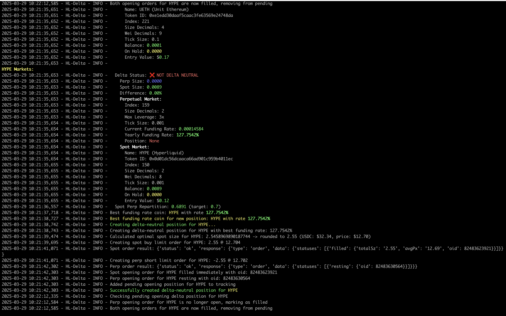

# HyperVault Delta Bot v2.0.0

A professional, modular delta-neutral trading bot for HyperLiquid exchange with clean architecture and industrial-grade code organization.


*Delta Bot taking a position on HyperLiquid Exchange*

## 🎉 What's New in V2

### Professional Package Structure
V2 introduces a complete architectural overhaul with proper separation of concerns:

```
src/delta_bot/
├── bot.py              # Main bot orchestration
├── config.py           # Configuration management
├── models.py           # Data models
├── market_data.py      # Market data & funding rates
├── trading.py          # Order execution
├── positions.py        # Position management
└── utils/              # Utility functions
```

### Key Improvements
- ✅ **Modular Design**: Each component has a single, well-defined responsibility
- ✅ **Better Testability**: Comprehensive test suite with pytest
- ✅ **Type Hints**: Full type annotations for better IDE support
- ✅ **Proper Packaging**: Install with `pip install -e .`
- ✅ **Professional Standards**: Follows Python best practices
- ✅ **Backward Compatible**: V1 code still works with minimal changes

## Features

- Implements delta-neutral trading strategies across spot and perpetual markets
- Automatically identifies the best funding rates for optimal yield
- Monitors and rebalances positions to maintain delta neutrality
- RESTful API for remote control and monitoring
- Handles order tracking and management
- Periodic checks to find better opportunities based on funding rates
- Graceful shutdown with position closing
- Comprehensive logging and error handling

## Quick Start

### Installation

```bash
# Clone the repository
git clone https://github.com/cgaspart/HL-Delta.git
cd HL-Delta

# Install with development dependencies
make install
# or: pip install -e ".[dev]"
```

### Using Makefile Commands

The project includes a Makefile for common tasks:

```bash
make help       # Show all available commands
make install    # Install package with dev dependencies
make test       # Run test suite with coverage
make run        # Start the bot
make example    # Run example script
make clean      # Remove build artifacts
make format     # Format code with black and isort
make lint       # Run linters
```

### Configuration

1. **Set up environment variables** (required for authentication):
```bash
export HYPERLIQUID_PRIVATE_KEY=your_private_key_here
export HYPERLIQUID_ADDRESS=your_eth_address_here
export API_SECRET_KEY=your_secret_key_here
```

Or create a `.env` file:
```env
HYPERLIQUID_PRIVATE_KEY=your_private_key_here
HYPERLIQUID_ADDRESS=your_eth_address_here
API_SECRET_KEY=your_secret_key_here
```

2. **Customize `config.json`** (optional, has sensible defaults):
```json
{
  "general": {
    "debug": false,
    "tracked_coins": ["BTC", "ETH", "HYPE", "USDC"],
    "autostart": true
  },
  "allocation": {
    "spot_pct": 70,
    "perp_pct": 30,
    "rebalance_threshold": 0.05
  },
  "trading": {
    "refresh_interval_sec": 60
  },
  "api": {
    "host": "0.0.0.0",
    "port": 8080,
    "enabled": true
  }
}
```

### Running the Bot

#### Basic Usage
```bash
# Run the example script to test configuration
python example.py

# Start the bot with API server
python entrypoint.py
```

#### Using the Package
```python
import asyncio
from delta_bot import DeltaBot

async def main():
    # Initialize the bot
    bot = DeltaBot(config_path="config.json")
    
    # Display current positions
    bot.display_position_info()
    
    # Start the bot
    await bot.start()

if __name__ == "__main__":
    asyncio.run(main())
```

## Architecture

### Core Components

#### 1. **DeltaBot** (`bot.py`)
Main orchestrator that coordinates all components:
- Initializes Hyperliquid clients
- Manages the main execution loop
- Coordinates position creation and monitoring

#### 2. **ConfigManager** (`config.py`)
Handles all configuration:
- Loads and validates `config.json`
- Manages environment variables
- Provides type-safe configuration access

#### 3. **MarketDataManager** (`market_data.py`)
Fetches and processes market data:
- Retrieves funding rates from Hyperliquid
- Calculates yearly funding rates
- Provides market price information

#### 4. **TradingManager** (`trading.py`)
Handles order execution:
- Places spot and perp orders
- Manages order cancellation
- Tracks order status

#### 5. **PositionManager** (`positions.py`)
Manages delta-neutral positions:
- Creates and closes positions
- Monitors pending orders
- Ensures position balance

#### 6. **Data Models** (`models.py`)
Type-safe data structures:
- `SpotMarket`: Spot market information
- `PerpMarket`: Perpetual market information
- `CoinInfo`: Combined market data
- `PendingDeltaOrder`: Order tracking

## API Endpoints

The bot provides a RESTful API for remote control:

### Bot Control
- `GET /api/bot/state` - Get current bot state
- `POST /api/bot/start` - Start trading operations
- `POST /api/bot/stop` - Stop trading operations
- `POST /api/bot/close-position/{coin}` - Close specific position
- `POST /api/bot/create-position/{coin}` - Create position for coin

### Status and Monitoring
- `GET /api/status` - Get current status and positions
- `GET /api/status/funding-rates` - Get funding rates
- `GET /api/status/positions` - Get all positions

### Configuration
- `GET /api/config` - Get current configuration
- `POST /api/config/update` - Update configuration
- `GET /api/config/tracked-coins` - Get tracked coins
- `POST /api/config/add-coin/{coin}` - Add tracked coin
- `POST /api/config/remove-coin/{coin}` - Remove tracked coin

## Testing

Run the test suite:

```bash
# Run all tests
pytest

# Run with coverage
pytest --cov=delta_bot --cov-report=html

# Run specific test file
pytest tests/test_config.py

# Run with verbose output
pytest -v
```

## Development

### Code Quality Tools

```bash
# Format code with black
black src/

# Sort imports with isort
isort src/

# Type checking with mypy
mypy src/

# Linting with flake8
flake8 src/
```

### Project Structure

```
HL-Delta/
├── src/delta_bot/          # Main package
│   ├── __init__.py
│   ├── bot.py
│   ├── config.py
│   ├── models.py
│   ├── market_data.py
│   ├── trading.py
│   ├── positions.py
│   └── utils/
├── api/                    # API server
├── tests/                  # Test suite
├── frontend/               # React frontend
├── config.json             # Configuration
├── entrypoint.py           # Main entry point
├── example.py              # Example usage
├── setup.py                # Package setup
├── pyproject.toml          # Modern Python config
├── requirements.txt        # Dependencies
└── README.md               # This file
```

## Frontend UI

The bot includes a React-based frontend for monitoring:

1. Start the backend:
   ```bash
   python entrypoint.py
   ```

2. Start the frontend:
   ```bash
   cd frontend
   npm install
   npm start
   ```

3. Configure frontend API key in `frontend/.env`:
   ```env
   REACT_APP_API_KEY=your_secret_key
   ```

4. Access the UI at `http://localhost:3000`

## Delta-Neutral Strategy

The bot implements a capital-efficient strategy:
- **Long spot positions** to earn the funding rate
- **Short perpetual futures** to hedge price risk
- **Automatic switching** to better opportunities when funding rates change

The system targets a 70/30 spot-to-perp allocation ratio for optimal capital efficiency.

## Configuration Options

### General Settings
- `debug`: Enable detailed debug logging
- `tracked_coins`: List of coins to monitor and trade
- `autostart`: Whether to start trading automatically

### Allocation Settings
- `spot_pct`: Percentage of capital for spot (default: 70%)
- `perp_pct`: Percentage of capital for perp (default: 30%)
- `rebalance_threshold`: Rebalancing threshold (default: 5%) // Not implemented

### Trading Settings
- `refresh_interval_sec`: Position check interval (default: 60s)

### API Settings
- `host`: API server host (default: 0.0.0.0)
- `port`: API server port (default: 8080)
- `enabled`: Enable API server (default: true)

## Monitoring and Logging

The bot provides comprehensive logging:

- **Console output**: Real-time colored terminal output
- **File logging**: Persistent logs in `delta.log`
- **WebSocket streaming**: Live log streaming to frontend
- **Structured logging**: Easy to parse and analyze

## Safety Features

- **Order timeout**: Automatically cancels stuck orders after 5 minutes
- **Position validation**: Ensures delta-neutral balance before execution
- **Error handling**: Graceful error recovery and logging
- **Graceful shutdown**: Closes positions on exit (configurable)
- **Rate limiting**: Respects exchange rate limits

## Performance

- **Efficient polling**: Configurable refresh intervals
- **Async operations**: Non-blocking I/O for better performance
- **Minimal dependencies**: Lightweight and fast
- **Resource efficient**: Low CPU and memory usage

## Troubleshooting

### Common Issues

**Import errors:**
```bash
# Make sure the package is installed
pip install -e .
```

**Configuration errors:**
```bash
# Verify config.json is valid JSON
python -m json.tool config.json
```

**API connection errors:**
```bash
# Check environment variables are set
echo $HYPERLIQUID_PRIVATE_KEY
echo $HYPERLIQUID_ADDRESS
```

## Contributing

Contributions are welcome! Please:

1. Fork the repository
2. Create a feature branch
3. Write tests for new functionality
4. Ensure all tests pass
5. Submit a pull request

## Versioning

### Current Version: 2.0.0

**Release Notes:**
- Complete architectural refactor with modular design
- Professional package structure
- Comprehensive test suite
- Type hints throughout
- Improved error handling
- Better documentation

## License

MIT License - see [LICENSE](LICENSE) file for details

## Disclaimer

This software is for educational purposes only. Use at your own risk. Trading cryptocurrencies involves significant risk of loss and is not suitable for all investors.

## Support

- **Documentation**: [README.md](README.md) and [MIGRATION_V2.md](MIGRATION_V2.md)
- **Issues**: [GitHub Issues](https://github.com/cgaspart/HL-Delta/issues)
- **Discussions**: [GitHub Discussions](https://github.com/cgaspart/HL-Delta/discussions)

## Star History

[](https://www.star-history.com/#cgaspart/HL-Delta&Date)

---

**Made with ❤️ by the HyperVault Team**
